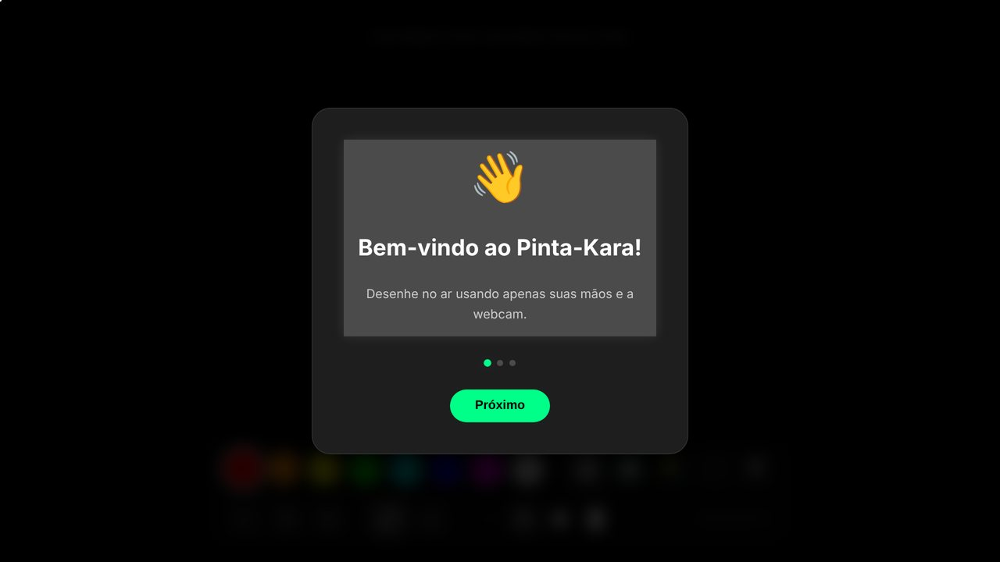

<div align="center">

# ✋ Pinta-Kara

**Desenhe no ar usando só as mãos e a webcam.**
Junte o polegar e o indicador (pinça) para desenhar, solte para parar.

[](https://pinta-kara.vercel.app)




</div>

## ✨ Como funciona

A câmera acompanha as duas mãos em tempo real. Faça a **pinça** com o polegar e o indicador para desenhar, e solte para parar. Os botões de cor e de ação também podem ser apertados com a mão, sem tocar no mouse.

1. Abra o [link](https://pinta-kara.vercel.app) e permita o uso da câmera.
2. Passe pelo tutorial de três telas.
3. Mostre as mãos, faça a pinça e desenhe.

## 🔒 Privacidade

Toda a visão computacional roda no navegador com o MediaPipe Hand Landmarker: **nenhuma imagem da câmera sai do seu computador**. O navegador só guarda se você já viu o tutorial de abertura.

## 🛠️ Rodar localmente

```bash
npm install
npm run dev       # desenvolvimento
npm run build     # build de produção em dist/
npm run preview   # serve o build
```

Precisa de uma webcam e de um navegador moderno. A câmera só funciona em `localhost` ou HTTPS.

## 🧱 Tecnologias

JavaScript, Canvas, [MediaPipe Tasks Vision](https://ai.google.dev/edge/mediapipe/solutions/vision/hand_landmarker) e Vite.

---

## 🌴 Mais do Peter

Este projeto faz parte do [**portfólio do Peter**](https://javaijafoi.vercel.app), uma vitrine de jogos, histórias interativas e experimentos com IA, todos no ar. Perfil no GitHub: [@javaijafoi](https://github.com/javaijafoi).

| Projeto | No ar | Código |
| --- | --- | --- |
| **Antigravitus**: Diário de aventuras num RPG de texto, jogado por agentes de IA | [abrir](https://antigravitus.vercel.app) | [repo](https://github.com/javaijafoi/antigravitus) |
| **Picotron Arena**: Dez modos de arcade num computador de fantasia | [abrir](https://picotron-arena.vercel.app) | [repo](https://github.com/javaijafoi/picotron-arcade) |
| **Jogo do Davi**: Jogo para crianças aprenderem a ler e a contar | [abrir](https://jogo-davi.vercel.app) | [repo](https://github.com/javaijafoi/Jogo-davi) |
| **Matusalém**: História interativa de mistério no Bixiga | [abrir](https://matusalem-six.vercel.app) | — |
| **Era Vargas: O Equilibrista**: Jogo 3D de decisões sobre o Brasil de 1930 a 1945 | [abrir](https://era-vargas-seliga.vercel.app) | [repo](https://github.com/javaijafoi/era-vargas-seliga) |
| **Rolador**: Dados para qualquer RPG de mesa, com cara de PICO-8 | [abrir](https://rolador-javaijafoi.vercel.app) | [repo](https://github.com/javaijafoi/rolador) |
| **iFone**: Celular de mentira para mesas de #iHunt | [abrir](https://ifone-javaijafoi.vercel.app) | [repo](https://github.com/javaijafoi/ifone) |
| **Pico Poetry**: Poemas em pixel para sortear e compartilhar como imagem | [abrir](https://pico-poetry.vercel.app) | — |
| **#iHunt Chronicle**: Mesa virtual para o RPG #iHunt (em pausa) | [abrir](https://ihunt-chronicle.vercel.app) | — |
| **iHunt App**: Fork do Fari App (Fate) para mesas de #iHunt | — | [repo](https://github.com/javaijafoi/iHunt-app) |

---

Feito por [@javaijafoi](https://github.com/javaijafoi) · parte do [portfólio](https://javaijafoi.vercel.app).
